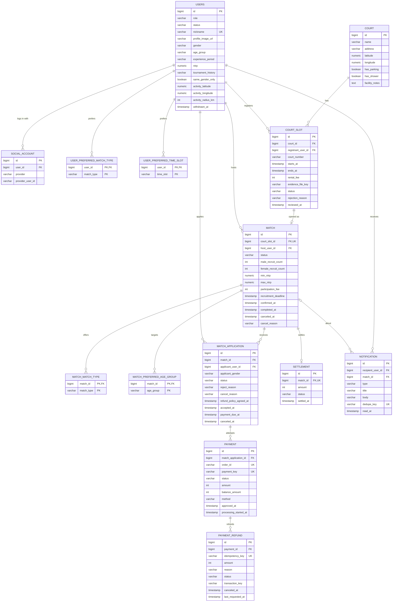

# Rallit MVP ERD

MVP 기능을 기준으로 설계한 데이터베이스 구조입니다.
PG 결제를 전제로 하며, 스키마는 Flyway로 관리합니다.

## 1. ERD

## 2. 주요 설계 사항

- **회원:** 카카오·구글 로그인을 지원하기 위해 `User`와 `SocialAccount`를 분리했습니다. 회원은 소셜 로그인 직후 `ONBOARDING` 상태로 생성되고, 온보딩을 마치면 `ACTIVE`가 됩니다.
- **매치:** 호스트는 참가 인원에 포함되며, 별도의 참가 신청이나 결제는 하지 않습니다. 전체 정원은 `1 + 남성 모집 인원 + 여성 모집 인원`입니다.
- **참가 신청:** 신청 → 호스트 수락 → PG 결제 → 참가 확정 순서로 진행합니다. 성별 잔여석은 신청 시점의 성별 스냅샷(`applicant_gender`)으로 계산합니다.
- **결제:** 결제 시도와 환불 이력을 분리하고, 결과 불명 상황을 위한 `UNKNOWN` 상태를 관리합니다.
- **지역:** 사용자 활동 지역은 중심 좌표와 반경으로 관리합니다.
- **삭제:** 결제·정산 기록 보존을 위해 회원과 매치는 물리 삭제하지 않습니다.

## 3. 주요 제약조건

- 소셜 계정은 `(provider, provider_user_id)` 조합으로 중복을 방지합니다.
- `ACTIVE` 회원은 닉네임과 성별이 필수입니다.
- 동일 코트·코트 번호의 시간 중복 등록을 제한합니다. 거절된 코트 슬롯은 제외합니다.
- 매치 전체 정원은 호스트 포함 2~6명입니다.
- 동일 사용자의 중복 진행 신청을 제한하되, 취소·거절 이력은 보존합니다.
- 신청당 진행 중이거나 성공한 결제는 1건, 결제당 진행 중인 환불은 1건으로 제한합니다.
- 결제 주문번호, PG 결제 키, 환불 멱등키, 알림 중복 방지 키에 UNIQUE 제약을 적용합니다.

## 4. 참고사항

- 현재 범위는 MVP로 제한합니다.
- 결제·환불·정산의 세부 정책은 기능 구현 시 확정합니다.
- 실제 스키마는 `src/main/resources/db/migration/V1__create_mvp_schema.sql`을 기준으로 합니다.
