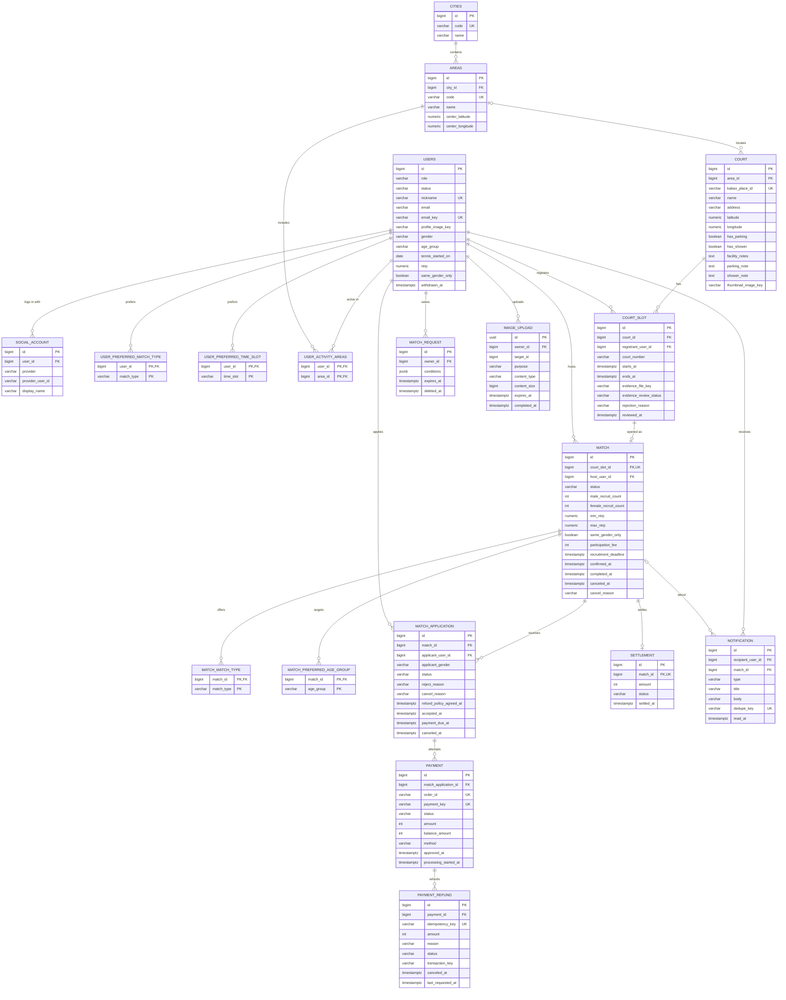

# Rallit MVP ERD

MVP 기능을 기준으로 설계한 데이터베이스 구조입니다.
PG 결제를 전제로 하며, 스키마는 Flyway로 관리합니다.

## 1. ERD

## 2. 주요 설계 사항

- **회원:** 카카오·구글 로그인을 지원하기 위해 `User`와 `SocialAccount`를 분리했습니다. 회원은 소셜 로그인 직후 `ONBOARDING` 상태로 생성되고, 온보딩을 마치면 `ACTIVE`가 됩니다. 테니스 경력은 시작 연월(`tennis_started_on`, 매월 1일로 저장)로 관리합니다.
- **지역:** 법정동코드 기준 시·도(`cities`)와 자치구(`areas`)를 관리합니다. 사용자 활동 지역은 자치구 다중 선택(`user_activity_areas`)으로 저장하고, 코트는 소속 자치구(`area_id`)를 가집니다. 자치구 중심 좌표는 매치 검색·추천의 거리 계산에 사용합니다.
- **코트:** 코트 공통 이용 안내(`facility_notes`)와 별도로 주차·샤워 시설별 이용 안내(`parking_note`, `shower_note`)를 관리합니다. 카카오 장소 검색으로 등록한 코트는 카카오 장소 ID(`kakao_place_id`)로 재사용합니다.
- **코트 예약:** 매치 개설 시 코트 예약(`court_slot`)과 매치를 함께 저장하고 매치는 즉시 `RECRUITING`으로 모집합니다. 예약 증빙 사진은 선택 사항이며 `evidence_review_status`(`NOT_SUBMITTED`, `PENDING`, `APPROVED`, `REJECTED`)는 운영자 검수 결과만 나타내고 모집 여부에는 영향을 주지 않습니다.
- **매치:** 호스트는 참가 인원에 포함되며, 별도의 참가 신청이나 결제는 하지 않습니다. 전체 정원은 `1 + 남성 모집 인원 + 여성 모집 인원`입니다. 매치 유형은 복수 선택(`match_match_type`)할 수 있습니다.
- **참가 신청:** 신청 → 호스트 수락 → PG 결제 → 참가 확정 순서로 진행합니다. 성별 잔여석은 신청 시점의 성별 스냅샷(`applicant_gender`)으로 계산합니다.
- **매칭 요청:** 사용자가 저장한 검색 조건을 `conditions`(JSONB)에 보관합니다. 만료 시각(`expires_at`)이 지나거나 삭제(`deleted_at`)되면 비활성 요청으로 봅니다.
- **결제:** 결제 시도와 환불 이력을 분리하고, 결과 불명 상황을 위한 `UNKNOWN` 상태를 관리합니다.
- **이미지:** 프로필·코트 썸네일 이미지는 S3 Presigned URL로 업로드하고, DB에는 URL 대신 객체 키(`profile_image_key`, `thumbnail_image_key`)만 저장합니다. 예약 증빙 사진도 같은 방식으로 업로드하고 `evidence_file_key`에 저장합니다. 업로드 발급 이력은 `image_upload`로 관리하며, `target_id`는 `purpose`에 따라 회원 ID(`PROFILE`, `RESERVATION_EVIDENCE`) 또는 코트 ID(`COURT`)를 가리킵니다.
- **삭제:** 결제·정산 기록 보존을 위해 회원과 매치는 물리 삭제하지 않습니다.

## 3. 주요 제약조건

- 소셜 계정은 `(provider, provider_user_id)` 조합으로 중복을 방지합니다.
- 닉네임과 이메일은 대소문자를 구분하지 않고 UNIQUE 제약을 적용합니다.
- `ACTIVE` 회원은 닉네임과 성별이 필수입니다.
- 회원 NTRP는 1.0~7.0, 매치 NTRP 범위는 1.0~4.0입니다. 매치의 4.0은 4.0 이상 구간을 의미합니다.
- 코트의 카카오 장소 ID에 UNIQUE 제약을 적용합니다.
- 동일 코트·코트 번호의 시간 중복 등록을 제한합니다. 증빙 검수 상태와 관계없이 모든 코트 슬롯에 적용합니다.
- 증빙 파일이 없으면 검수 상태는 `NOT_SUBMITTED`, 있으면 그 외 상태여야 합니다.
- 매치 전체 정원은 호스트 포함 2~6명입니다.
- 동일 사용자의 중복 진행 신청을 제한하되, 취소·거절 이력은 보존합니다.
- 신청당 진행 중이거나 성공한 결제는 1건, 결제당 진행 중인 환불은 1건으로 제한합니다.
- 결제 주문번호, PG 결제 키, 환불 멱등키, 알림 중복 방지 키에 UNIQUE 제약을 적용합니다.
- 이미지 업로드는 JPEG·PNG 형식, 최대 5MB로 제한합니다.

## 4. 참고사항

- 현재 범위는 MVP로 제한합니다.
- 결제·환불·정산의 세부 정책은 기능 구현 시 확정합니다.
- 실제 스키마는 `src/main/resources/db/migration`의 Flyway 마이그레이션(V1~V23)을 기준으로 합니다.
